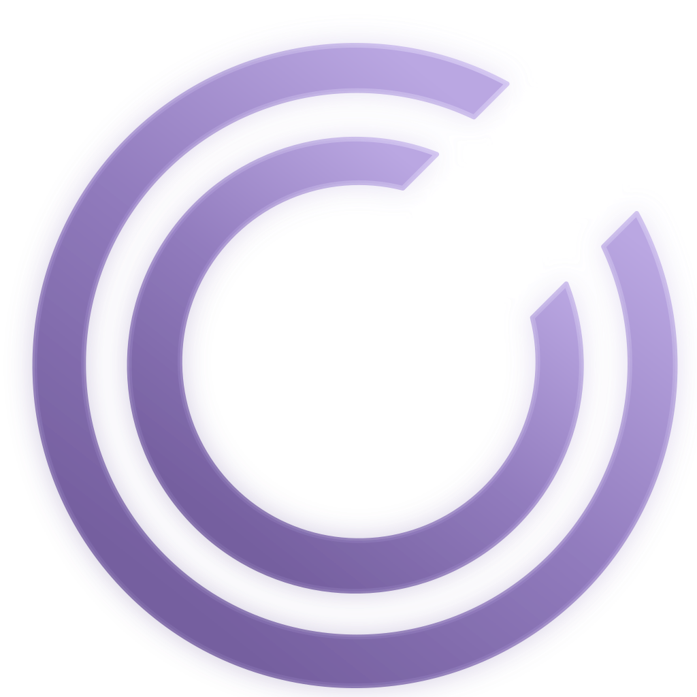

<div align="center">



# orBIT

</div>

**orBIT** — десктопный клиент со сквозным шифрованием (E2EE), позволяющий безопасно обмениваться сообщениями, совершать аудио- и видеозвонки, а также отправлять файлы на компьютерах с Windows, macOS и Linux.

## Сборка и запуск

Для сборки требуются **Node.js** (v20+) и **Rust** (компилятор `cargo` для нативного модуля).

```bash
# Клонирование и установка зависимостей
git clone https://github.com/orbitmsg/orBIT.git
cd orBIT
npm install

# Запуск в режиме разработки
npm run dev

# Сборка установочного пакета
npm run electron:build
```

## Нашли баг?

Пожалуйста, проверьте [существующие Issues](https://github.com/orbitmsg/orBIT/issues), чтобы избежать дубликатов перед созданием нового отчёта.

## Есть вопрос или предложение?

Если у вас есть вопрос или идея по улучшению функционала, создайте тему в [Issues](https://github.com/orbitmsg/orBIT/issues).

## Уведомление о криптографии

Данный дистрибутив включает в себя программное обеспечение со сквозным шифрованием (Double Ratchet, X3DH, Curve25519/Ed25519, AES-256-GCM). В стране вашего постоянного проживания могут действовать ограничения на импорт, владение, использование или реэкспорт программного обеспечения для шифрования. Перед использованием любого криптографического ПО ознакомьтесь с законодательством вашей страны. Подробнее: http://www.wassenaar.org/.

## Лицензия

Распространяется под лицензией [GNU General Public License v3.0 (GPLv3)](LICENSE).
